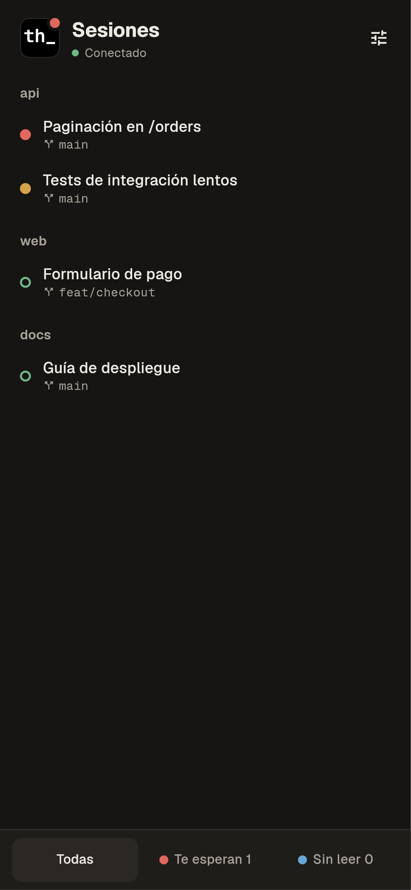
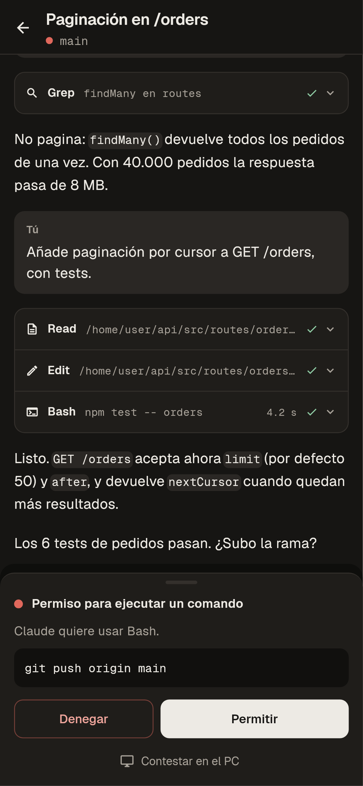

# therd

Vista de chat para Claude Code dentro de [herdr](https://herdr.dev), desde el móvil. Sin
terminal: ves cada sesión como un chat, le escribes, la paras y contestas permisos, preguntas
y planes desde Android, también desde la notificación con el móvil bloqueado.

Un daemon en el PC junta los hooks HTTP de Claude Code, el transcript JSONL de cada sesión y la
API por socket de herdr. La app Flutter se conecta a él por WebSocket a través de
[Tailscale](https://tailscale.com); nada sale de tu red.

Es un proyecto personal y no oficial: no tiene relación con Anthropic.

<p align="center">
  
  &nbsp;
  
</p>

## Qué hace

- Lista las sesiones de Claude Code agrupadas por workspace de herdr, con su estado en vivo
  (trabajando, esperando, terminada sin leer).
- Chat de cada sesión: mensajes, razonamiento plegado, tarjetas por herramienta (diff de las
  ediciones, comando y salida de Bash, capturas) y subagentes con su actividad.
- Escribir a Claude, con dictado por voz y hasta 4 imágenes de la galería o la cámara, y pararlo
  (Escape).
- Contestar permisos, preguntas y planes. Con la app abierta, el hook espera tu respuesta; con
  la app cerrada, el diálogo sale en el terminal como siempre y te llega una notificación con
  botones.
- Aviso cuando una sesión termina un turno y nadie lo ha visto. Lo leído se sincroniza entre el
  PC y el móvil.

## Requisitos

- Linux con [herdr](https://herdr.dev), donde corren las sesiones de Claude Code.
- Claude Code reciente (con hooks HTTP).
- [Tailscale](https://tailscale.com) en el PC y en el móvil, en la misma tailnet.
- [Dart SDK](https://dart.dev/get-dart) 3.10 o superior para compilar el daemon.
- [Flutter](https://docs.flutter.dev/get-started/install) (Dart 3.10.7 o superior) y el SDK de
  Android para compilar la app. Solo hay app para Android.
- Opcional, para las notificaciones: Docker (servidor ntfy) y la app ntfy en el móvil.

## Puesta en marcha

### 1. Compilar e instalar el daemon

```sh
git clone https://github.com/pabloraw/therd.git && cd therd
cd daemon && dart pub get && cd ..
dart compile exe daemon/bin/therd.dart -o ~/.local/bin/therd
```

`~/.local/bin` tiene que estar en el `PATH`. La primera vez que se ejecuta, therd crea
`~/.config/therd/config.json` con un token aleatorio (ver [Configuración](#configuración)).

### 2. Instalar los hooks en Claude Code

```sh
therd install --dry-run   # enseña el diff sin escribir nada
therd install
```

Añade los hooks de therd a `~/.claude/settings.json` sin tocar los que ya tengas y deja una copia
de seguridad al lado. `therd uninstall` los quita.

Los hooks mandan el token en la variable `THERD_TOKEN`. Expórtala en el shell donde arranca
herdr (por ejemplo en `~/.zshrc` o `~/.bashrc`):

```sh
export THERD_TOKEN=$(jq -r .token ~/.config/therd/config.json)
```

Sin ella los hooks llegan igual (el daemon solo los escucha en `127.0.0.1`), pero con ella el
daemon rechaza cualquier hook con un token distinto. Si prefieres no usar la variable,
`therd install --literal-token` escribe el token en `settings.json`.

Las sesiones de Claude Code que ya estaban abiertas leen los hooks al arrancar: hay que
reabrirlas (`claude --resume`).

> Alternativa: `plugin/` es un plugin de Claude Code con los mismos hooks, para quien prefiera
> gestionarlos como plugin. Usa también `THERD_TOKEN` y el puerto 24600.

### 3. Arrancar el daemon

Para probar, en primer plano:

```sh
therd serve
```

Para dejarlo siempre en marcha, con la unidad de usuario de systemd de
[`deploy/systemd/therd.service`](deploy/systemd/therd.service):

```sh
mkdir -p ~/.config/systemd/user
cp deploy/systemd/therd.service ~/.config/systemd/user/
systemctl --user daemon-reload
systemctl --user enable --now therd
journalctl --user -u therd -f   # log
```

Si el servicio puede arrancar antes que Tailscale, fija `bindHost` con tu IP de Tailscale en
`config.json`: así espera a que exista en vez de quedarse escuchando solo en `127.0.0.1`.

`therd doctor` revisa la instalación: herdr, Tailscale, puertos, hooks, permisos del config y
ntfy.

### 4. Instalar la app

Con el móvil conectado por USB y la depuración USB activada:

```sh
cd app
flutter pub get
flutter build apk --release
flutter install   # o: adb install build/app/outputs/flutter-apk/app-release.apk
```

Sin keystore propio, el APK release se firma con la clave debug. Para firmarlo con la tuya, ver
[app/README.md](app/README.md).

### 5. Emparejar

En el PC:

```sh
therd pair
```

Saca un QR y la URL `therd://<ip-de-tailscale>:24601?token=…`. En la app, «Escanear QR», o pega
host, puerto y token a mano. Desde ese momento la app ve las sesiones de herdr.

### 6. Notificaciones (opcional)

Sin este paso la app funciona, pero solo te enteras de los permisos y fines de turno con ella
abierta. Las notificaciones usan UnifiedPush con un servidor ntfy propio en el PC:

```sh
TS_IP=$(tailscale ip -4) docker compose -f deploy/ntfy/compose.yaml up -d
```

Después, la sección `ntfy` en `config.json`, la app ntfy en el móvil apuntando a tu servidor y
`therd notify-test` para probar. Los pasos completos y cómo funciona por dentro están en
[docs/notificaciones.md](docs/notificaciones.md).

## Configuración

`~/.config/therd/config.json` (modo 600; therd lo crea y nunca sobrescribe uno que no pueda
leer):

| Campo | Por defecto | Qué es |
|---|---|---|
| `token` | aleatorio | Token de la app y de los hooks. Si lo cambias, vuelve a emparejar. |
| `hookPort` | `24600` | Puerto de los hooks, solo en `127.0.0.1`. |
| `appPort` | `24601` | Puerto del WebSocket y de las imágenes para la app. |
| `bindHost` | IP de Tailscale | IP donde escucha el WebSocket. Sin Tailscale cae a `127.0.0.1`. |
| `pendingTimeoutSeconds` | `120` | Cuánto espera un hook retenido antes de pasar al terminal. Menos de 180 (el timeout de los hooks). |
| `ntfy` | sin notificaciones | `url`, `topic` y `token` opcional del servidor ntfy. |

Los puertos, el bind y el timeout también se pasan como opciones de `therd serve`
(`--hook-port`, `--app-port`, `--bind` y `--pending-timeout`). Variables de entorno:

| Variable | Para |
|---|---|
| `THERD_TOKEN` | Token que mandan los hooks. |
| `THERD_CONFIG_DIR` | Carpeta de config (`~/.config/therd`). |
| `THERD_CLAUDE_DIR` | Carpeta de Claude Code (`~/.claude`). |
| `HERDR_SOCKET_PATH` | Socket de herdr (`~/.config/herdr/herdr.sock`). |
| `THERD_UPLOADS_DIR` | Imágenes enviadas desde la app (`~/.cache/therd/uploads`). |
| `THERD_IMAGES_DIR` | Imágenes de los transcripts (`~/.cache/therd/images`). |

## Seguridad

- Los hooks solo escuchan en `127.0.0.1` y rechazan peticiones de navegador.
- El WebSocket escucha en la IP de Tailscale, nunca en `0.0.0.0`, y exige el token. El tráfico va
  por `ws://` y `http://`, cifrado por el túnel de Tailscale (WireGuard).
- Quien tenga el token puede escribir a Claude y aprobar permisos en tu PC. Trátalo como una
  contraseña: si se filtra, borra `token` de `config.json`, reinicia el daemon y vuelve a
  emparejar.
- La app no entra en las copias de seguridad de Android.

## Límites

- Las respuestas desde el móvil a diálogos del terminal se pulsan como teclas y dependen de los
  textos de Claude Code (capturas en `daemon/test/fixtures/`). Una actualización de Claude Code
  puede romperlas.
- El formato del transcript es interno de Claude Code y puede cambiar.
- Las sesiones fuera de herdr se ven, pero no se les puede escribir desde el móvil.

## Desarrollo

```
packages/protocol/   modelos y mensajes compartidos (Dart puro, JSON a mano)
daemon/              ejecutable therd
app/                 app Flutter (Android)
plugin/              plugin de Claude Code con los hooks
deploy/              ntfy en Docker y unidad de systemd
docs/                arquitectura y notificaciones
```

Cada paquete es independiente y depende de `protocol` con una path dependency:

```sh
cd packages/protocol && dart pub get && dart analyze && dart test
cd daemon && dart pub get && dart analyze && dart test
cd app && flutter pub get && flutter analyze && flutter test
```

Cómo funciona por dentro: [docs/arquitectura.md](docs/arquitectura.md) y
[docs/notificaciones.md](docs/notificaciones.md). La especificación original está en
[INVESTIGACION.md](INVESTIGACION.md) y el estado del proyecto en [ESTADO.md](ESTADO.md).

## Licencia

MIT, ver [LICENSE](LICENSE). Las fuentes Geist de `app/assets/fonts` van con su propia licencia,
SIL OFL 1.1, en `app/assets/fonts/OFL-Geist.txt`.
